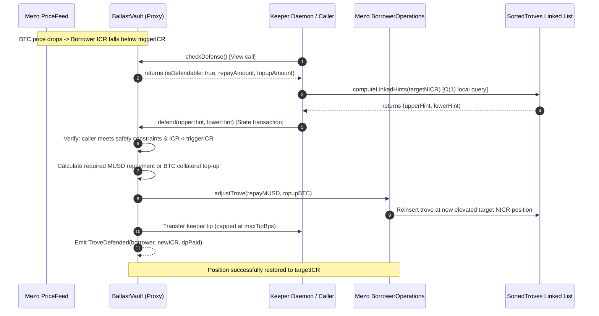

# Ballast — Autonomous Liquidation Guardian for MUSD Troves

[-E16839.svg)](https://explorer.test.mezo.org)
[](https://docs.soliditylang.org/)
[](https://nextjs.org/)
[](https://www.typescriptlang.org/)
[](#test-suite--verification)
[](./LICENSE)
[](https://x.com/Siddhu_3116)

> **Ballast** is an automated, non-custodial defense system that protects Bitcoin-backed MUSD troves on the Mezo network from liquidation and redemption by maintaining a pre-funded defense reserve.

When an individual collateral ratio (ICR) drops below a user-configured safety trigger, permissionless keepers autonomously execute pre-funded MUSD debt repayments or native BTC collateral top-ups, instantly lifting the borrower's position back to safety.

---

## Table of Contents

- [The Problem \& The Ballast Solution](#the-problem--the-ballast-solution)
- [System Architecture](#system-architecture)
- [Liquidation Defense Lifecycle](#liquidation-defense-lifecycle)
- [Verified Smart Contracts](#verified-smart-contracts-mezo-matsnet-31611)
- [Mathematical Formulation](#mathematical-formulation)
- [Key Features \& dApp Capabilities](#key-features--dapp-capabilities)
- [Monorepo Structure](#monorepo-structure)
- [Serverless 24/7 Keeper (`convex/`)](#serverless-247-keeper-convex)
- [Permissionless Defense (`scripts/defend-manually.ts`)](#permissionless-defense-scriptsdefend-manuallyts)
- [Test Suite \& Verification](#test-suite--verification)
- [Developer Quickstart](#developer-quickstart)
- [Author \& Community](#author--community)
- [License](#license)

---

## The Problem & The Ballast Solution

### The Liquidation & Redemption Challenge on Mezo
Borrowers on Mezo deposit native Bitcoin to mint MUSD stablecoins. Because Bitcoin is volatile:
1. **Liquidation Threshold (MCR 110%)**: If a trove's Individual Collateral Ratio (ICR) drops below 110%, any third party can liquidate it. The borrower loses their Bitcoin collateral at distressed market prices, incurs a 0.5% liquidation penalty, and permanently forfeits their 200 MUSD gas reserve.
2. **Redemption Vulnerability**: During market volatility or peg deviations, MUSD holders redeem MUSD for collateral from the lowest-collateralized troves first, even if those troves are healthy (>110% ICR).
3. **Manual Response Latency**: Borrowers sleeping or away from screens during flash crashes cannot manually bridge funds, approve tokens, and execute trove adjustments in time.

### The Ballast Solution
Ballast gives borrowers a dedicated, non-custodial guardian:
- **EIP-1167 Minimal Proxy Vault**: Each borrower deploys an isolated, non-custodial vault through `BallastFactory`. Only the borrower can deposit or withdraw funds.
- **Pre-Funded Reserves**: Borrowers pre-fund a defense reserve with MUSD, BTC, or both.
- **Customizable Safety Rules**: Borrowers specify their exact `triggerICR` (e.g., 125%), `targetICR` (e.g., 140%), and `maxTipBps` (e.g., 50 bps).
- **Permissionless Keeper Network**: When ICR drops below `triggerICR`, any keeper can trigger `BallastVault.defend()`. The vault automatically computes the optimal repayment/top-up, interacts with Mezo's `BorrowerOperations`, restores the ICR to `targetICR`, and pays a capped tip to the caller.

---

## System Architecture

```
                                      +---------------------------------------------+
                                      |                 Mezo Network                |
                                      |              (Chain ID: 31611)              |
                                      +---------------------------------------------+
                                                             |
                 +-------------------------------------------+-------------------------------------------+
                 |                                                                                       |
                 v                                                                                       v
+-----------------------------------+                                           +-----------------------------------+
|      Ballast Smart Contracts      |                                           |       Mezo Protocol Core          |
|                                   |                                           |                                   |
| +-------------------------------+ |                                           | +-------------------------------+ |
| |        BallastFactory         | |                                           | |      BorrowerOperations       | |
| | (Deterministic Proxy Factory) | |                                           | |     (Trove Adjustments)       | |
| +---------------+---------------+ |                                           | +---------------+---------------+ |
|                 | clones (EIP-1167)                                           |                 |
|                 v                 |                                           |                 v
| +-------------------------------+ |                                           | +-------------------------------+ |
| |         BallastVault          | | -- adjustTrove(repay, topup) -----------> | |         TroveManager          | |
| |   (Isolated Borrower Proxy)   | |                                           | |   (Accounting & Position)     | |
| |   - Pre-funded MUSD Reserve   | | <------- ICR & Debt/Coll Data -------     | +---------------+---------------+ |
| |   - Pre-funded BTC Reserve    | |                                           |                 |
| |   - User Safety Rules         | | -- getPrice() --------------------------> | +-------------------------------+ |
| +---------------+---------------+ |                                           | |           PriceFeed           | |
|                 ^                 |                                           | |       (BTC/USD Oracle)        | |
+-----------------|-----------------+                                           | +---------------+---------------+ |
                  |                                                             |                 |
                  | defend()                                                    | +-------------------------------+ |
                  |                                                             | |         SortedTroves          | |
+-----------------+-----------------+                                           | |   (Linked-List Trove Order)   | |
|     Autonomous Keeper Network     |                                           | +-------------------------------+ |
|                                   |                                           |                 |
| - 24/7 Serverless Convex Daemon   |                                           | +-------------------------------+ |
| - Atomic compare-and-set locks    |                                           | |          MUSD Token           | |
| - Fallback manual CLI script      |                                           | |   (Canonical Stablecoin ERC20)| |
| - Telegram Instant Alert Bot      |                                           | +-------------------------------+ |
+-----------------------------------+                                           +-----------------------------------+
```

---

## Liquidation Defense Lifecycle



---

## Verified Smart Contracts (Mezo Matsnet 31611)

All Ballast core contracts are deployed, active, and verified on **Mezo Matsnet (Chain ID 31611)**.

### Ballast Core Contracts

| Contract Name | Role / Purpose | Deployed Address | Explorer Link | Source File |
| :--- | :--- | :--- | :--- | :--- |
| **`BallastFactory`** | Deterministic minimal proxy factory | `0x8d5b392839300b487addeecc35f5bc534111cd33` | [View on Explorer](https://explorer.test.mezo.org/address/0x8d5b392839300b487addeecc35f5bc534111cd33) | [`BallastFactory.sol`](./packages/contracts/src/BallastFactory.sol) |
| **`BallastVault`** *(Active Vault &bull; Most Active)* | Primary live borrower defense vault (highest transaction volume on Matsnet) | `0xA506b2250B85A0c7dE80DD313A0Db9cD8a655D5A` | [View on Explorer](https://explorer.test.mezo.org/address/0xA506b2250B85A0c7dE80DD313A0Db9cD8a655D5A) | [Verified Tx](https://explorer.test.mezo.org/tx/0xa668c363368da7af882524f60198bda8051fd6940f95a1e7dab4f5f8d80d72ca) |
| **`BallastVault`** *(Logic)* | Master implementation for defense logic & reserves | `0x815893bad1708a201eeeaf226eed576a7ffea4bc` | [View on Explorer](https://explorer.test.mezo.org/address/0x815893bad1708a201eeeaf226eed576a7ffea4bc) | [`BallastVault.sol`](./packages/contracts/src/BallastVault.sol) |
| **`BallastMath`** | Pure 1e18 fixed-point math library | *Linked Library* | [View Contract](#mathematical-formulation) | [`BallastMath.sol`](./packages/contracts/src/libraries/BallastMath.sol) |

### Mezo Protocol Canonical Dependencies

| Contract | Matsnet Address | Function in Ballast |
| :--- | :--- | :--- |
| **`BorrowerOperations`** | `0xCdF7028ceAB81fA0C6971208e83fa7872994beE5` | Adjusts trove debt and collateral atomically |
| **`TroveManager`** | `0xE47c80e8c23f6B4A1aE41c34837a0599D5D16bb0` | Source of truth for borrower debt, collateral, and status |
| **`PriceFeed`** | `0x86bCF0841622a5dAC14A313a15f96A95421b9366` | Chainlink BTC/USD oracle price feed |
| **`SortedTroves`** | `0x722E4D24FD6Ff8b0AC679450F3D91294607268fA` | Ordered linked list of troves sorted by NICR |
| **`MUSD Token`** | `0x118917a40FAF1CD7a13dB0Ef56C86De7973Ac503` | ERC-20 stablecoin used for trove debt repayment |

---

## Mathematical Formulation

All calculations in Ballast follow **`BallastMath.sol`**, using pure 1e18 fixed-point arithmetic verified against precision fuzz tests:

### 1. Individual Collateral Ratio (ICR)
$$\text{ICR} = \frac{\text{Collateral} \times \text{Price}}{\text{Debt}} \times 100\%$$

### 2. Debt Repayment Deficit (MUSD Defense)
When defending by repaying debt, the target debt level is:
$$\text{Debt}_{\text{target}} = \frac{\text{Collateral} \times \text{Price}}{\text{TargetICR}}$$

The required repayment amount is:
$$\Delta \text{Debt} = \text{Debt}_{\text{current}} - \text{Debt}_{\text{target}}$$

### 3. Collateral Deficit (BTC Top-up Defense)
When defending by adding collateral:
$$\text{Collateral}_{\text{target}} = \frac{\text{Debt} \times \text{TargetICR}}{\text{Price}}$$

The required BTC top-up amount is:
$$\Delta \text{Collateral} = \text{Collateral}_{\text{target}} - \text{Collateral}_{\text{current}}$$

### 4. Keeper Incentive Tip Calculation
The keeper tip is strictly bounded by user-defined constraints:
$$\text{Tip} = \min\left(\text{DefendedAmount} \times \frac{\text{MaxTipBps}}{10000},\; \text{MaxTipAbsolute}\right)$$

---

## Key Features & dApp Capabilities

1. **Interactive Collateral Ratio Simulator**:
   - Dynamic client-side simulator on the landing page and app shell.
   - Adjust BTC price, debt, and volatility to visualize real-time ICR transitions across Healthy, Caution, and Liquidation zones.
2. **Borrower App Shell (`/app`)**:
   - **Overview Dashboard**: Live trove metrics, ICR gauge, and active safety status.
   - **Position Health Monitor**: Real-time collateral, principal, and pending interest breakdown.
   - **Safety Rules Manager**: Configure trigger ICR (e.g., 130%), target ICR (e.g., 150%), and keeper tip BPS.
   - **Reserve Management**: Non-custodial deposit & withdrawal interface for BTC and MUSD defense buffers.
   - **Stress-Testing Lab**: Simulate price shocks (-10% to -60%) and model automated defense buffer sufficiency.
3. **24/7 Mobile Alerts via Telegram**:
   - Direct wallet-to-Telegram linking authenticated via EIP-191 cryptographic signatures.
   - Automated push notifications when ICR reaches warning thresholds or when a defense transaction is executed.
4. **Rich Aesthetic Design**:
   - Editorial, classical collage aesthetic celebrating Florentine architecture and the Renaissance spirit of Bitcoin.
   - Custom typography, dynamic hardware-accelerated scroll reveal slide-ins, and zero mock data.

---

## Monorepo Structure

```
BALLAST/
├── apps/
│   ├── web/                 # Next.js 15 App Router dApp (React 19, Tailwind CSS)
│   │   ├── src/app/         # Landing page, /app/* routes, /whitepaper
│   │   ├── src/components/  # Layout, Header, Footer, Gauges, Simulators
│   │   └── src/lib/         # Wagmi, Viem, and Mezo Matsnet connectors
│   └── keeper/              # Core keeper execution logic & dependency injection
├── convex/                  # 24/7 Serverless backend (cron loop, webhooks, DB)
│   ├── schema.ts            # Typed tables (vaults, snapshots, defenses, alerts)
│   ├── crons.ts             # 30-second automated monitor loop
│   ├── keeper.ts            # Atomic lease coordination & transaction submission
│   ├── telegram.ts          # Telegram webhook handler & wallet verification
│   └── http.ts              # /healthz and /telegram/webhook HTTP endpoints
├── packages/
│   ├── contracts/           # Foundry smart contracts (Solidity 0.8.24)
│   │   ├── src/             # BallastFactory.sol, BallastVault.sol, BallastMath.sol
│   │   ├── test/            # Fork test suite pinned to Mezo Matsnet block 16250250
│   │   └── script/          # Deploy.s.sol idempotent deployment script
│   └── shared/              # Shared pure math, protocol addresses, ABIs, branding
├── deployments/             # Canonical deployment artifacts (matsnet.json)
├── docs/                    # Technical whitepapers, protocol notes, keeper budget
└── scripts/                 # Operational tools (defend-manually.ts, smoke.ts)
```

---

## Serverless 24/7 Keeper (`convex/`)

Ballast features a production serverless keeper architecture deployed on Convex's free tier, requiring **zero dedicated server hosting**:

- **Execution Cadence**: 30-second cron interval (`crons.interval('monitor', { seconds: 30 })`).
- **Atomic Compare-and-Set Leases**: Prevents race conditions and ensures exactly one worker uses the keeper nonce per tick.
- **Strict Free-Tier Budget**: Consumes under 26% of Convex's monthly function call quota (<260,000 / 1,000,000 calls) and <1 MB storage.
- **Public Health Endpoint**: `GET https://<deployment>.convex.site/healthz` reports tick age, monitored vault count, and keeper wallet balance with zero secret exposure.

```bash
# Start Convex development daemon
npx convex dev

# Execute a single keeper inspection tick manually
npx convex run keeper:tick
```

---

## Permissionless Defense (`scripts/defend-manually.ts`)

Ballast is 100% permissionless. Even if the Convex keeper were offline, **anyone can defend any vault** directly from their terminal and collect the keeper tip:

```bash
# 1. Check if a vault is currently defendable (Dry-run, no private key required)
npx tsx scripts/defend-manually.ts --vault 0xA506b2250B85A0c7dE80DD313A0Db9cD8a655D5A --dry-run

# 2. Execute defense on-chain and claim keeper reward
npx tsx scripts/defend-manually.ts --vault 0xA506b2250B85A0c7dE80DD313A0Db9cD8a655D5A --key 0x<YOUR_PRIVATE_KEY>
```

---

## Test Suite & Verification

Ballast enforces strict engineering guidelines per [AGENTS.md](./AGENTS.md):
- **NO Mocks in Product Code**: All UI numbers originate directly from verified RPC calls or pure math.
- **Rule 2 Clean Bundle Audit**: Test doubles and burner connectors are strictly prohibited from production builds.

```bash
# 1. Run Foundry Fork Tests against Mezo Testnet (Matsnet block 16250250)
cd packages/contracts
forge test --fork-url https://rpc.test.mezo.org -vvv

# 2. Run TypeScript unit and integration tests (Vitest)
pnpm test

# 3. Verify clean bundle (guarantees zero test doubles in production)
node scripts/check-clean-bundle.js

# 4. Strict TypeScript typecheck across all workspace packages
pnpm --recursive run typecheck
```

---

## Developer Quickstart

### Prerequisites
- Node.js >= 20.x
- `pnpm` >= 9.x
- [Foundry](https://book.getfoundry.sh/) (`forge`, `anvil`, `cast`)

### Installation & Local Setup

```bash
# Clone the repository
git clone https://github.com/SIDDHUX9/BALLAST.git
cd BALLAST

# Install workspace dependencies
pnpm install

# Copy environment template
cp .env.example .env

# Build shared package
pnpm --filter @ballast/shared build

# Start local web development server
pnpm dev
```

Visit [`http://localhost:3000`](http://localhost:3000) to view the dApp.

---

## Author & Community

- **Creator**: Siddhu — [X (@Siddhu_3116)](https://x.com/Siddhu_3116)
- **Repository**: [github.com/SIDDHUX9/BALLAST](https://github.com/SIDDHUX9/BALLAST)
- **Network**: [Mezo Network](https://mezo.org) | [Mezo Developer Docs](https://mezo.org/docs/developers) | [Mezo Testnet Explorer](https://explorer.test.mezo.org)

---

## License

This project is licensed under the [MIT License](./LICENSE).